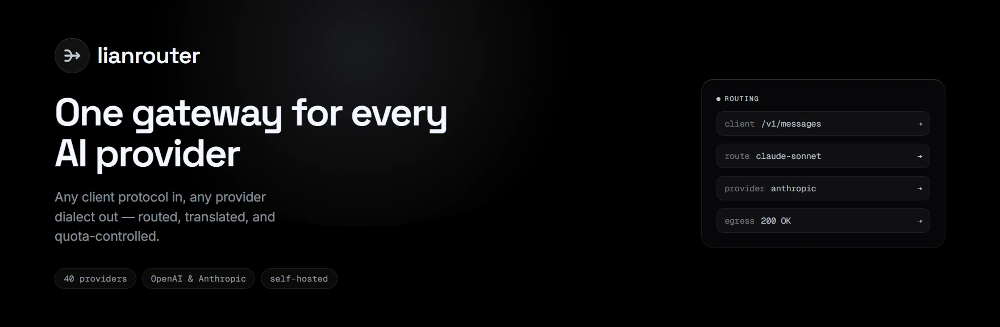
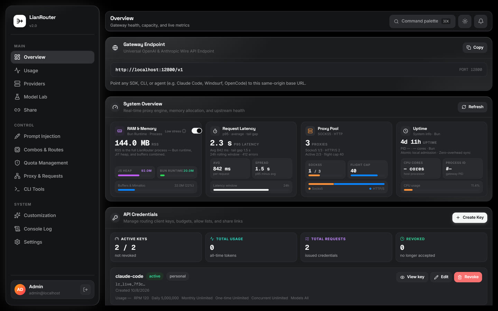
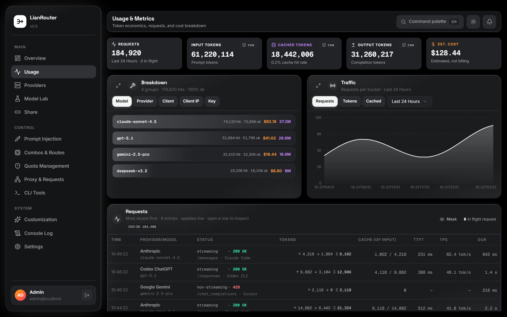
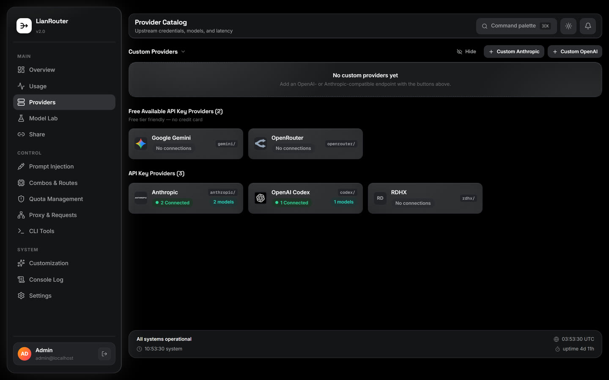
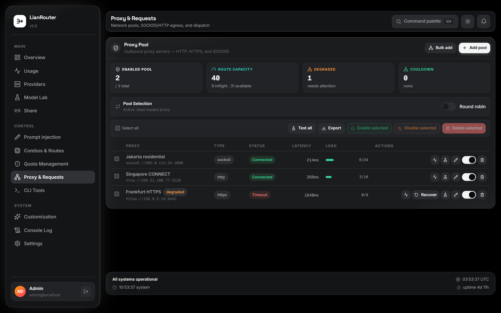
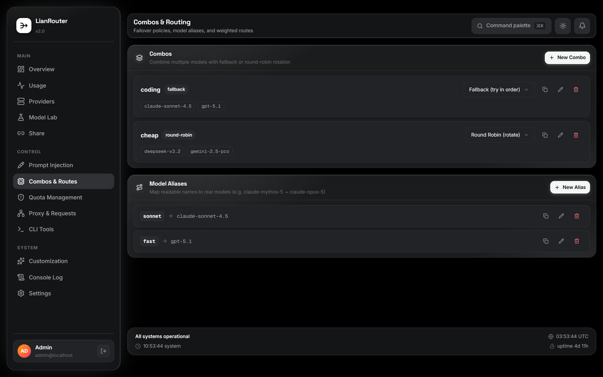
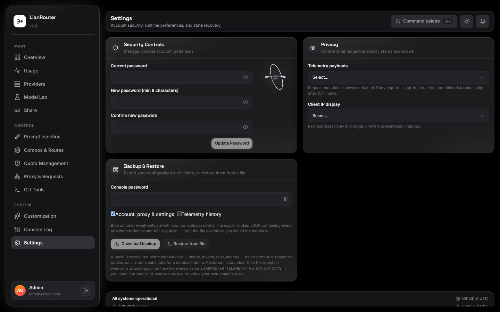
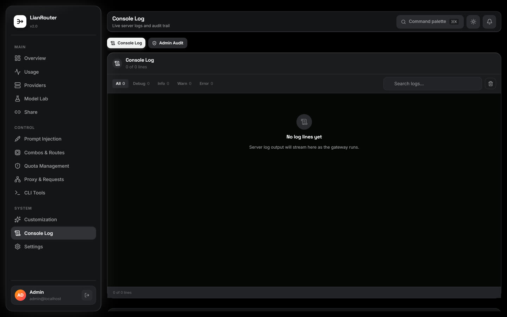

# LianRouter



**A self-hosted AI gateway that speaks every client protocol and every provider
dialect — so you configure a route once, and any client can reach any model.**

<p>
  
  
  
  
</p>

This repository is the **self-hosted build**: one process, one PostgreSQL
database, and the console on `http://localhost:12800`. Clone it and run it on
your own machine or LAN. It is developed and published at
<https://github.com/ReXooGen/Lian-Router>.

> **This is not a hosted service.** There is no account, no shared
> infrastructure, and no telemetry leaving the machine. If a separate private
> deployment exists, it is a different working copy with its own configuration
> and release cadence — not this repository, and not something this repository
> deploys to.

LianRouter sits between your AI clients and your provider accounts. It accepts
the wire formats real tools already speak, normalizes every one of them into a
single canonical request, then routes that request across provider accounts and
models under admission control, capability checks, health tracking, and
validated egress.

The result is one endpoint, one key, one console. Point Claude Code, Codex,
Cursor, or any OpenAI-compatible client at it, and let the gateway work out which
account serves the request, whether the provider can express what the client
asked for, and what to do when it cannot.

Built with Bun, TypeScript, Elysia, PostgreSQL, and optional Redis coordination.

> **Credit.** LianRouter is a router built from **Cartethyia**, the self-hosted
> AI gateway this project started from, and modified for personal use. The
> routing engine, provider integrations, and console architecture come from that
> upstream. This fork is rebranded, trimmed to a console-only distribution, and
> configured for local use.

## Contents

- [Screenshots](#screenshots)
- [Highlights](#highlights)
- [Supported client protocols](#supported-client-protocols)
- [Request lifecycle](#request-lifecycle)
- [Requirements](#requirements)
- [Run it locally](#run-it-locally)
- [Desktop launcher](#desktop-launcher)
- [Console](#console)
- [Share access and tunnels](#share-access-and-tunnels)
- [Configuration](#configuration)
- [Development commands](#development-commands)
- [Tests and coverage](#tests-and-coverage)
- [Docker](#docker)
- [Providers and egress](#providers-and-egress)
- [Generated protobuf](#generated-protobuf)
- [Repository map](#repository-map)

## Screenshots

These are the real console screens, captured locally at
`http://localhost:12800` against a fresh install. Every value shown is sample
data from a throwaway local instance — no operator credentials, provider keys,
API tokens, or production endpoints appear in them.

### Overview



### Usage



### Providers



### Proxy & Requests



### Combos & Routes



### Settings



### Console Log



## Highlights

- **92 bundled provider integrations** — OpenAI, Anthropic, Codex, Gemini, Grok,
  Cursor, Devin, Mistral, Groq, OpenRouter, Cerebras, NVIDIA, Cloudflare,
  DeepSeek, Cohere, Together, Hyperbolic, Fireworks, xAI, Meta's Model API, the
  Alibaba and MiniMax families, and more, each with its own authentication, wire
  quirks, and identity headers.
- **Four client protocols, one canonical model** — Chat Completions, Responses,
  Messages, and legacy Completions all normalize into the same request shape.
  A client's protocol is a property of the connection, not of the route.
- **Capability-aware routing that translates instead of rejecting** — when a
  chosen model cannot express something the client asked for, the request is
  degraded in place (generation controls dropped, media replaced by placeholders)
  rather than silently rerouted to a model you never asked for.
- **Account health as a state machine** — every failure is classified into
  `active` / `degraded` / `cooldown` / `disabled`, with per-account and per-model
  backoffs, automatic recovery, and a full transition log you can read.
- **Share access without leaking a key** — a share template issues one child
  key per client IP from a bearer enrollment link. The parent secret is never
  shown, the child is scoped by the template, and every recipient's usage is
  visible in the console.
- **Validated egress pools** — HTTP CONNECT, HTTPS CONNECT, and SOCKS5, with
  SSRF validation at both creation and connection time. Configured pool failures
  surface as failures; a request never silently falls back to direct egress.
- **Multi-tenant by construction** — scoped personal API keys, non-authenticating
  share templates that enroll one child per trusted client IP, model allow/deny
  policies, and per-key rate and token budgets.
- **Observability you can act on** — per-request telemetry, bounded and redacted
  payload capture, Prometheus metrics, a live console log, and JSON export /
  import for moving configuration between deployments.

## Supported client protocols

Each surface below has a real handler, codec, and test suite behind it. The
gateway accepts a client's own wire format and normalizes it — the protocol is a
property of the connection, not of the route you configure.

| Surface | Path | Notes |
|---|---|---|
| Chat Completions | `/v1/chat/completions` | The broadest compatibility surface |
| Responses | `/v1/responses` | Native for Codex; reasoning, tools, hosted tools |
| Responses compact | `/v1/responses/compact` | Native Codex compaction |
| Messages | `/v1/messages` | Anthropic-native; what Claude Code speaks |
| Completions | `/v1/completions` | Legacy text completion |
| Embeddings | `/v1/embeddings` | OpenAI-shaped vectors; non-streaming only |
| Models | `/v1/models` | Read-only catalog listing (`/v1/models/info` for detail) |

Anything else under `/v1/` is not routed. A path the gateway does not serve
returns `404` with `{"error":{"code":"not_found"}}` rather than being forwarded
upstream, so a typo surfaces immediately instead of reaching a provider.

Requests authenticate with either `Authorization: Bearer <key>` or
`x-api-key: <key>`. Sending both is rejected rather than resolved, so a client
cannot be ambiguous about which credential it meant.

## Request lifecycle

Every request walks the same path, which is what makes the behavior predictable:

```text
ingress (single body read)
  → ordered pipeline (readiness → identity → IP-abuse → API-key auth
                      → canonical parse → route prepare)
  → plan (alias → combo → ambiguity → eligibility → capability filter
          → provider-routing reorder)
  → leases (admission → pool slot → reservation)
  → provider adapter dispatch (stream primed before the 200 commits)
  → completeAttempt (usage, health, capture, exactly one telemetry row)
```

Routing, admission, retry, accounting, and telemetry are shared across every
surface — a `/v1/messages` request and a `/v1/chat/completions` request travel the
same path once they are canonical.

## Requirements

- Bun 1.4.2, for the runtime and for every build, test, and release script
- PostgreSQL (local or reachable on your network)
- Redis for `REDIS_MODE=normal`

PostgreSQL is external in native and Docker setups. Redis is optional when using
`REDIS_MODE=single_instance_local`, which is the simplest setup for a single
machine.

## Run it locally

The whole path from a clone to a working console:

```bash
bun install
cp .env.example .env
```

Edit `.env` and set at least:

```text
DATABASE_URL=postgres://postgres:<password>@localhost:5432/lianrouter
LIANROUTER_ENCRYPTION_KEY=<64 hex characters>
```

Generate the key with `openssl rand -hex 32`, or
`bun -e "console.log(require('crypto').randomBytes(32).toString('hex'))"`. Keep
it: it encrypts stored provider credentials, and losing it makes them
unreadable.

Then add the console password. This is the only credential that opens the
console — there is no username and no account setup:

```text
LIANROUTER_CONSOLE_PASSWORD=local-console-2026
```

That is the password a fresh install ships with, and the login screen prints it
while it is still in use. Replace it with your own value: the hint disappears as
soon as the configured password is no longer the default.

The hint is a promise about a password that works, so it appears only while the
environment value is the **effective** password. Once the console takes ownership
— a password changed from Settings → Security Controls — the hint is gone even if
`LIANROUTER_CONSOLE_PASSWORD` still holds the default, because at that point the
environment value is only a rotation trigger. The two ways back are changing
`LIANROUTER_CONSOLE_PASSWORD` to a **different** value (a changed value reclaims
ownership) or resetting the password from the console while signed in.

```bash
bun run setup     # creates the schema and seeds the provider catalog
bun run dev       # backend + console on http://localhost:12800
```

Open `http://localhost:12800/`; the root redirects into `/console/` and asks for
that password. Nothing leaves your machine unless you add a provider account and
route a request through it.

`LIANROUTER_CONSOLE_PASSWORD` is the **initial** password. You can change it
from Settings → Security Controls: the console stores only an argon2id hash, and
that hash becomes authoritative, so the new password survives a restart. This is
what lets a public deployment set its own password without shell access to
`.env`.

To take the password back from the console — including when you have forgotten
it — change `LIANROUTER_CONSOLE_PASSWORD` and restart. A changed environment
value reclaims ownership and is applied on the next boot; an unchanged one
leaves the console-managed password in place.

The password is never stored in plaintext, and no environment value is copied
into the database: a database dump carries only a hash. Leave
`LIANROUTER_CONSOLE_PASSWORD` unset to fall back to per-user accounts with a
first-boot setup wizard — that mode is for a deployment shared by several
operators.

`bun run dev` runs the stack behind a supervisor proxy on that same port: press
**CTRL+R** in its terminal to restart backend + dashboard in place — client
requests arriving during the restart gap are held (added latency, no
`connection refused`) until the backend is listening again. **CTRL+C** stops
everything. `bun run dev:stack` runs the raw stack without the supervisor.

Useful endpoints:

```text
/health       liveness
/health/ready readiness
/metrics      Prometheus metrics
/v1/*         gateway APIs
/console      admin console (root redirects here)
/share/:token public child-key enrollment
```

## Desktop launcher

The gateway also ships as a global command. Install it once and `lianrouter`
starts the gateway, opens the console, or hands it to the tray:

```bash
bun add -g lianrouter
lianrouter
```

```text
========================================
  Choose Interface (v2.0.0)
  🚀 Server: http://localhost:12800
========================================

  > Update to v2.0.5 (current: v2.0.0)
    Web UI (Open in Browser)
    Terminal UI (Interactive CLI)
    Hide to Tray (Background)
    Exit
```

`bun` is the primary install path: the package's bin runs under the Bun runtime
and declares `engines.bun`, so `npm i -g lianrouter` works only where `bun` is
already on `PATH`. Subcommands skip the menu — `lianrouter start`, `stop`,
`status`, `update`, `tray`, `tui` — and `--port`, `--host`, `--no-open`,
`--background` cover the rest. The launcher is a separate package that starts
and updates the gateway process; it is not on the request path.

The package ships the launcher only, so the **first run** installs the gateway:
`lianrouter` finds no binary in the install root, downloads the release archive
for this platform while showing progress, verifies its sha256, and installs it
atomically. An archive without a published digest is refused rather than
installed, and a platform with no published build is told so by name instead of
failing at spawn. Nothing is downloaded during `bun add -g` / `npm i -g` — the
install stays offline, and `status`, `stop`, `--version`, and `--help` never reach
the network at all. Later runs find the binary and start offline.

Installing the gateway is not the same as configuring it: it still needs
`DATABASE_URL` (and `REDIS_URL` when `REDIS_MODE=normal`) in its environment or a
`.env` in its working directory before `/health` can answer — see
[Configuration](#configuration). A first run that installs cleanly and then
cannot start is a configuration problem, and the launcher prints the gateway's
own error line instead of a bare health timeout.

The tray is the way to leave the gateway running without a console window:
`lianrouter tray`, or the menu's **Hide to Tray** row, starts the gateway, hides
the console, and leaves an icon in the notification area. Right-click gives Open
Console, Restart Server, Stop Server, Check for Updates, and Exit; a left
double-click opens the console. The tray is Windows only — on macOS and Linux
the command exits with a message pointing at running `lianrouter` in a terminal.

The console can start an update itself. When the launcher reports a newer
release, the console shows a dialog naming the target version; confirming it
streams live download and install progress, the gateway restarts when the
install finishes, and the page reloads once the new binary answers. The install
is performed by the launcher, not by the gateway — a running binary cannot
replace itself. An update is refused when the release asset has no published
sha256 digest, and the console reports updates as unavailable when the gateway
was not started by the launcher, because there is then no launcher to run the
install.

From a checkout, run it without installing: `bun run cli:dev`.

See [cli/CLI.md](cli/CLI.md) for the install root, the control plane, the update
flow, and the tray.

## Console

This build ships the console only. The gateway serves no public marketing page:
`GET /` redirects to `/console/`, and the console is the entire browser surface.
The console covers the whole operational surface:

- **Overview** — traffic, success rate, latency, and provider health at a glance
- **Usage** — per-request telemetry with request detail and payload inspection
- **Providers** — accounts, credentials, health, per-account in-flight limits,
  today/lifetime token usage, and per-model probing
- **Model Lab** — exercise a model directly and see the raw exchange
- **Combos & Routes** — model combos, aliases, and CLI-tool mappings
- **Quota Management** — account quota, check-in state, and refresh control
- **Proxy & Requests** — egress pools, reachability tests, and dispatch history
- **CLI Tools** — map a coding agent's model slots onto your own routes
- **Customization, Console Log, Settings** — runtime configuration, live logs,
  and backup/restore

The console also surfaces an available update and can start the install, showing
progress until the gateway restarts.

Access is a single password (`LIANROUTER_CONSOLE_PASSWORD`) in front of the
whole console, so opening the dashboard never exposes the router without it.
The same secret gates the console API: every page, every mutation, and the
backup export/import flows sit behind it.

## Share access and tunnels

The **Share** page lets you hand out access without revealing a parent
credential. Create an API key in **Share template** mode, open **Share**, and
press **Create enrollment link**. The link is a bearer token whose hash alone is
stored; the recipient opens it, receives one child key scoped by the template,
and the parent secret is never shown to them.

A recipient can only be reached if the address in that link resolves for them.
On a machine reachable only over loopback, the link is `http://127.0.0.1:12800/…`
and is useless to anyone else — so expose the gateway first.

### Exposing the gateway

Any tunnel that forwards HTTPS to the gateway works; two that need no account
setup for a quick test:

```bash
# Cloudflare quick tunnel — prints https://<random>.trycloudflare.com
cloudflared tunnel --url http://localhost:12800

# ngrok
ngrok http 12800
```

Then set both values below and restart the gateway:

```text
LIANROUTER_PUBLIC_ORIGIN=https://<your-public-host>
LIANROUTER_PUBLIC_BASE_URL=https://<your-public-host>
TRUSTED_PROXY_CIDRS=127.0.0.1/32,::1/128
```

- `LIANROUTER_PUBLIC_BASE_URL` is what makes enrollment links and the `/v1`
  address shown to recipients point at the public host instead of the loopback
  address the tunnel dialed. Without it the link still works for you and fails
  for everyone else.
- `TRUSTED_PROXY_CIDRS` tells the gateway to read the client address from
  `CF-Connecting-IP` / `X-Forwarded-For`. Share enrollment allows one child key
  per client IP; without this every visitor looks like `127.0.0.1` and the
  second person to open the link is refused with "already issued". Set it to the
  tunnel's own address, never to a range a visitor could originate from.

Cloudflare quick tunnels and free ngrok rotate their hostname on restart, so
update `LIANROUTER_PUBLIC_BASE_URL` when that happens. A named Cloudflare
tunnel or a stable reverse proxy avoids the churn.

Two things stay true behind a tunnel: the console password still gates every
console route, and `/v1` still requires an API key. Exposing the port does not
open the router by itself.

## Configuration

`.env.example` is the configuration reference. Required values for a real run:

```text
DATABASE_URL
LIANROUTER_ENCRYPTION_KEY
LIANROUTER_PUBLIC_ORIGIN
REDIS_URL                    # unless REDIS_MODE=single_instance_local
```

`LIANROUTER_PUBLIC_BASE_URL` is optional and only matters when the address
recipients use differs from the address the gateway sees — a tunnel or a reverse
proxy. See [Share access and tunnels](#share-access-and-tunnels).

When the gateway runs behind a reverse proxy, set `TRUSTED_PROXY_CIDRS` to the
proxy's CIDRs (for a loopback proxy, `127.0.0.1/32,::1/128`). Without it the
gateway sees every visitor as the proxy's own address, which collapses the
per-client-IP rules — share-link enrollment in particular — onto a single
identity. Leave it unset when nothing sits in front of the gateway, so a client
cannot forge its own address.

The environment drift test keeps literal `process.env.*` reads documented:

Per-tenant runtime settings control request-body capture: `telemetryPayloads`
defaults to `bounded` (redacted, size-limited, 15-minute TTL) and `none` is the
kill-switch for new payload rows. The active environment template also exposes
the local `.jsonb` backing-store directory, file-size bound, and retention
override.

```bash
bun test test/config-env-drift.test.ts
```

## Development commands

```bash
bun run dev
bun run dev:backend
bun run dashboard:dev
bun run setup
bun run doctor
bun run typecheck
bun run dashboard:typecheck
bun run dashboard:build
bun run build:aot
bun run build:binary
bun run build
bun run build:cli
bun run build:release
bun run cli:dev
```

`bun run build` produces the standalone binary in three steps: build the
dashboard assets, run the Elysia AOT precompile into `dist/main.js`, then
compile that output into `dist/lianrouter`. The binary step reads the AOT output
rather than `src/main.ts` — the AOT pass rewrites TypeBox into statically wired
imports, and bundling the raw source instead leaves an unresolvable
`require("typebox/type")` in the executable. It also bakes `NODE_ENV=production`
into the artifact, which the binary needs in order to find `<cwd>/migrations`
and to avoid the development-only pretty-print log transport.

The compile target defaults to the host platform. Deploying to a different one
requires naming it, because the default silently produces a binary the server
cannot execute:

```bash
bun run scripts/build-binary.ts --outfile dist/lianrouter --target bun-linux-x64
```

`bun run build:release` packages the release artifact:
`dist/release/lianrouter-<platform>-<arch>.zip` with the gateway executable,
`migrations/`, and `dist/dashboard/` at the archive root — the exact shape the
first-run installer and the updater expect. It prints the archive's sha256,
which the GitHub release asset's `digest` field must carry, because both refuse
an artifact without one. It refuses to run when `dist/lianrouter` /
`dist/lianrouter.exe` is missing, so `bun run build` comes first.

## Tests and coverage

Tests live under the root `test/` tree. Backend tests mirror the production
layout; cross-cutting suites are grouped under `test/contracts`,
`test/integration`, `test/architecture`, and `test/frontend`.

```bash
bun run test
bun run test:contracts
bun run test:integration
bun run check:coverage
```

The offline coverage gate requires at least 75% line coverage for handwritten
backend `src/` code. DB-gated tests may be skipped when
`LIANROUTER_TEST_DATABASE_URL` is not configured; when it is, the suite runs
against that database and leaves `DATABASE_URL` alone.

## Docker

```bash
docker compose up --build -d
docker compose logs -f app
docker compose down
```

The Docker image builds the dashboard and compiled backend, runs as a dedicated
non-root user, and exposes port `12800`. PostgreSQL must be reachable through
`DATABASE_URL`; Compose manages Redis only.

### Moving a configuration between machines

The application applies its migration baseline at boot, so a new database needs
no manual step — but a database that already existed before a baseline change
may need the hand-run statements under `drizzle/migrations/manual/`. Those are
never applied automatically; their headers say so, and they are idempotent.

To move your configuration to another machine, use **Settings → Backup** in the
console:

1. On the old machine, export a backup. It downloads as plain JSON and contains
   every provider credential and API-key hash, so treat the file as secret.
   Export requires the console password.
2. On the new machine, start LianRouter against an empty database and wait for
   `/health/ready` to return `200`. Boot creates the schema and seeds the
   bundled provider catalog, which the import depends on.
3. Import the file there. It re-authenticates the same way.

A backup carries a tenant's own configuration and its request telemetry, not the
shared built-in catalog (the build re-supplies that) and not captured
prompt/response bodies. Restore replaces the importing tenant's config rows,
merges telemetry without duplicating it, and cannot touch another tenant's rows.
It is not a substitute for a database dump.

## Providers and egress

Provider integrations live under `src/providers/integrations/`. Generated
protobuf output consumed by Cursor and Devin integrations is committed under
their integration directories.

Supported network pool transports are:

- HTTP CONNECT
- HTTPS CONNECT
- SOCKS5

Pool endpoints are SSRF-validated at creation and connection time. Configured
pool failures are surfaced; requests do not silently fall back to direct egress.

## Generated protobuf

Cursor and Devin integrations consume committed protobuf output under their own
integration directories (`src/providers/integrations/*/generated/`). It is
build input: normal typecheck, build, setup, and Docker build read it as-is and
never regenerate it, so none of them need Buf, network access, or external code
generation. Regenerating is a separate, deliberate step.

## Repository map

```text
src/        production backend
 test/      backend and contract tests
 dashboard/ React/Vite dashboard (route and browser-boundary map in `dashboard/README.md`)
 cli/       publishable launcher package (own `package.json`, `tsconfig.json`)
 scripts/   flat operational scripts
 drizzle/   database migrations
 docs/      screenshots used by this README
 .github/   CI workflow
```

`cli/` is typechecked and built separately — `bun run --cwd cli typecheck` and
`bun run build:cli` — because the root `tsc` does not include it. Its layer doc
is `cli/CLI.md`.

For repository-local coding conventions and cleanup rules, see `AGENTS.md`.

## A self-contained checkout

This repository keeps its own `.env` and database, and nothing here is deployed
automatically anywhere. Running a separate deployment is a deliberate act you
perform yourself, against an independent copy with its own configuration and
release cadence. See [LOCAL.md](LOCAL.md) for the rules that keep one instance
independent of another.
