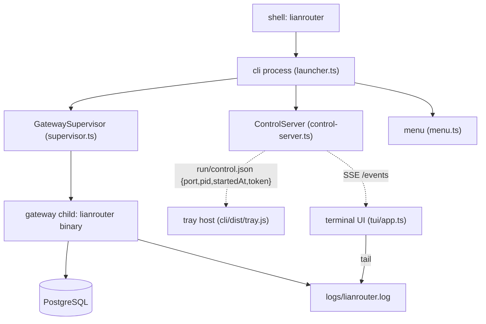

# CLI

`cli/` is the launcher: a globally installable package whose single command,
`lianrouter`, starts the gateway, opens its console, keeps it alive in the
background, and updates it. It is a **separate package** from the gateway — its
own `package.json`, its own `tsconfig.json`, its own publish cycle — and it sits
on no request path. Every `/v1/*` and `/console/api/*` byte belongs to the
gateway child process the launcher supervises.

The launcher owns three things the gateway cannot own for itself: the process
lifecycle (a gateway that crashes while nobody watches), the install tree (a
binary, `migrations/`, `dist/dashboard/` that must be replaced together), and a
local command channel the tray icon and terminal UI can call without a
credential.

## Layout

```text
cli/
  CLI.md                 this file
  README.md              package landing page for the registry
  package.json           publishable package; bin `lianrouter` -> ./dist/cli.js
  tsconfig.json          extends the repo config, scoped to cli/src + cli/tray + cli/test
  src/
    main.ts              bin entry: shebang, argv hand-off, exit code
    launcher.ts          argv parse, action dispatch, session wiring
    bootstrap.ts         first-run install: fetch, verify, extract, install
    paths.ts             install/state layout, dev-checkout discovery
    version.ts           CLI_VERSION, read from package.json
    supervisor.ts        gateway child lifecycle (start/stop/restart/health/restart budget)
    control-server.ts    loopback HTTP control plane + SSE event stream
    menu.ts              arrow-key menu renderer + prompt (numbered fallback)
    tray-launcher.ts     detached tray spawn, console-window hiding
    update-flow.ts       the ordered update sequence; gateway stays up until the install boundary
    progress.ts          first-run progress rendering, TTY vs pipe
    shutdown.ts          SIGINT/SIGTERM teardown and handshake removal
  update/
    contracts.ts         UpdatePhase/UpdateProgress/UpdateChannel + version compare
    github-source.ts     release feed + per-platform asset selection
    download.ts          streamed download with inline sha256 verification
    extract.ts           zip/tar/7z extraction into a staging directory
    install.ts           atomic install with rollback; dev-checkout refusal
    engine.ts            checkForUpdate() / runUpdate()
    version-file.ts      records the installed version after a committed install
  tui/
    app.ts               the interactive console: poll, reduce, render, act
    state.ts             pure view model + reducers
    render.ts            frame renderer (pure, width-exact)
    terminal.ts          ANSI primitives, alternate screen, size fallback
    input.ts             raw-mode key decoder
  tray/                  Windows tray host (spawned as `cli/dist/tray.js`)
    host.ts              tray entry: pid file, control wiring, command dispatch
    pump.ts              non-blocking message loop, popup menu, tray callback
    win32.ts             user32/shell32/kernel32/gdi32 bindings, icon primitives
    icon.ts              runtime HICON generation
    paths.ts             install-root resolution + control-file validation
    protocol.ts          menu item ids shared with the launcher
    control-client.ts    typed loopback control client
    connection.ts        handshake resolution + recovery (callWithReconnect, callRecovering)
    resurrect.ts         headless launcher respawn, waiting for a new handshake
    state.ts             tray-state classification + console URL fallback
    update-watch.ts      classifyUpdateOutcome + watchUpdate polling GET /update/state
  test/                  launcher-local suites
```

`scripts/build-cli.ts` bundles `cli/src/main.ts` → `cli/dist/cli.js` and
`cli/tray/host.ts` → `cli/dist/tray.js`, with minification off — a launcher that
dies on a user's machine is debugged from its stack trace, and a minified one has
none. `--compile` additionally produces a standalone executable for machines
without Bun on `PATH`. Every path in that script is anchored to the script's own
location rather than the process cwd, because `prepublishOnly` runs it from
`cli/`; the build also pins the cwd it bundles from, so `bun run build` in
`cli/` and `bun run build:cli` at the repository root emit byte-identical
bundles.

## Install and run

```bash
bun add -g lianrouter
lianrouter
```

`bun` is the honest primary path: the package's bin carries a
`#!/usr/bin/env bun` shebang and declares `engines.bun`, so the launcher needs
the Bun runtime on `PATH` regardless of which package manager put it there.
`npm i -g lianrouter` installs the same package and produces the same `lianrouter`
command, but it only runs where `bun` is already available.

With no arguments `lianrouter` starts the gateway (or adopts one already
running), then opens the menu:

```text
========================================
  Choose Interface (v2.0.0)
  🚀 Server: http://localhost:12800
========================================

  > Update to v2.0.5 (current: v2.0.0)
    Web UI (Open in Browser)
    Terminal UI (Interactive CLI)
    Hide to Tray (Background)
    Exit
```

The update row exists only when a newer release applies to this host, which is
why the box is four rows on a current install and five when an update is
available. Arrow keys (or `j`/`k`) move, Enter selects, `q` or Ctrl-C exits. On a
pipe — CI, a redirected stdin — `promptMenu` falls back to a numbered prompt
instead of entering raw mode, because raw mode on a pipe never emits keypresses
and would hang the process forever.

Subcommands skip the menu:

```bash
lianrouter start --port 12810     # foreground, then the menu
lianrouter status                 # print state and exit
lianrouter stop                   # stop the supervised gateway
lianrouter update                 # check, install, restart
lianrouter tray                   # background gateway + tray icon
lianrouter tui                    # terminal console
lianrouter --version
lianrouter --help
```

`--no-open` suppresses the browser, `--background` starts detached and returns,
`--headless` stays resident with the control server up and no menu, `--host` is
passed to the gateway as `HOST`. An unknown flag or command is an error, not a
silent no-op: a typo that quietly starts nothing is worse than a usage line.

### First run

The published package contains the launcher only. The gateway — the compiled
executable plus `migrations/` and `dist/dashboard/` — is a release artifact, so a
machine that has never run LianRouter has an install root with nothing in it.
`ensureGatewayInstalled()` in `cli/src/bootstrap.ts` closes that gap before the
supervisor is constructed:

1. If `<installRoot>/lianrouter[.exe]` exists, return immediately. This is the
   path every later run takes: no release source is constructed, no request is
   made, and a machine with no network still starts.
2. Otherwise create the install root, log `gateway not installed; fetching the
   latest release`, and ask `checkForUpdate()` for the release matching this
   host.
3. Refuse — never install — when the release has no asset for this platform, no
   sha256 digest, or (as the release feed reports it) no release at all. Each
   case names itself: a published release with no build for `win32-x64` tells you
   so and points at the releases page; an empty feed says no release is published
   yet.
4. Download to a temp directory under `os.tmpdir()`, verify the sha256 inline,
   extract into a staging directory, and hand both to `installAtomically()`. The
   temp directory is removed in a `finally`, so a failed first run leaves no
   half-archive behind.
5. Assert the binary is where the supervisor will look for it, then write
   `version.json`. A release whose archive nests its payload one level deep
   installs "successfully" and then leaves the launcher spawning a path that does
   not exist; this assertion turns that silent loop into a message listing what
   the archive actually contained, and it runs first so a rejected archive never
   records a version for an install that cannot start.

The download happens on first **run**, not during `bun add -g` / `npm i -g`. The
package's `postinstall` prints that fact and does nothing else: an install that
reaches the network breaks offline and CI installs.

Two invocations skip the bootstrap entirely, because they answer a question about
the current machine rather than start anything: `lianrouter status` and
`lianrouter stop`. `--help` and `--version` return before it too. A source
checkout never bootstraps at all — `resolveRuntime()` finds the repository and
runs `src/main.ts` through Bun instead.

When the install fails, `GatewayNotInstalledError` reaches the bin entry as a
one-line `lianrouter: <message>`. That is deliberate: a first run that printed a
stack trace would read as a launcher bug rather than as "this platform has no
published build".

## The install root

`resolveInstallRoot()` in `cli/src/paths.ts` decides where everything lives:

| Platform | Default root |
|---|---|
| Windows | `%LOCALAPPDATA%\LianRouter` (falls back to `~/AppData/Local`) |
| macOS | `~/Library/Application Support/LianRouter` |
| Linux | `$XDG_DATA_HOME/LianRouter`, else `~/.local/share/LianRouter` |

`LIANROUTER_HOME` overrides the whole layout. A relative value is resolved
against the process cwd once, at resolution time, so a later `chdir` cannot
silently move the install.

```text
<installRoot>/
  lianrouter            gateway executable (lianrouter.exe on Windows)
  migrations/           applied by the gateway at boot
  dist/dashboard/       console assets the gateway serves
  version.json          version + install timestamp recorded after an update
  logs/lianrouter.log   append-only child stdout/stderr
  run/lianrouter.pid    gateway pid; presence means "this root has a gateway"
  run/control.json      { port, pid, startedAt, token } control handshake
  run/tray.pid          tray host pid
  cache/updates/        downloaded release artifacts, one directory per version
```

The install root is the unit of update: the gateway binary, `migrations/`, and
`dist/dashboard/` are replaced together, and the updater replaces exactly the
top-level entries a release archive carries. That is why the launcher keeps its
mutable state in the same root — one directory to replace, one directory to back
up, one directory to delete.

Nothing produces that tree on its own. The three pieces are built separately and
assembled by whoever is shipping:

- `scripts/build-binary.ts` compiles `dist/lianrouter[.exe]` from the AOT output.
- `bun run dashboard:build` emits `dist/dashboard/`.
- `drizzle/migrations/` is the migration source of truth; the install root calls
  it `migrations/` because the compiled binary resolves `<cwd>/migrations` in
  production mode. `Dockerfile` copies it into `/app/migrations`, and
  `scripts/ops-start-binary.ts` mirrors it into a local `./migrations` before
  starting the binary.
- `scripts/build-release.ts` stages those three entries flat and zips them into
  `dist/release/lianrouter-<platform>-<arch>.zip`, which is exactly what
  `pickAssetForPlatform()` selects and what the first-run bootstrap installs. It
  prints the archive's sha256 for the release asset's digest, because an asset
  without one is refused by the engine.

State is deliberately separate from where the code was installed from: a package
manager's global prefix can be read-only, so `resolveStateDir()` derives the
`run/` tree from the install root rather than from the bundle's location.

## Process model



Ownership is one-directional and worth stating plainly:

- The **CLI process** owns the control server, the menu, and the decision to
  keep or stop the child on exit. It does not serve traffic.
- The **supervisor** owns the child's lifecycle inside that process: spawn,
  health wait, log pumping, restart budget, pid file. Nothing else calls
  `Bun.spawn` for the gateway.
- The **gateway child** owns the port, the database, and every request. The
  launcher never speaks HTTP to a provider and never touches the database.
- The **tray host** owns a Win32 message pump and nothing else. It calls the
  control plane for every action.

`resolveRuntime()` picks what to spawn: from a source checkout the child is
`bun run <repo>/src/main.ts`; from an install it is the compiled binary in the
install root. Getting that wrong is a confusing "file not found" at the first
start, so the decision is made once, at the top of the run.

### Supervisor invariants

- **One gateway per install root.** `run/lianrouter.pid` is the lock.
  `adoptExisting()` reads it, checks the pid is alive, and reports `running`
  without spawning; a stale file is removed so the next start can claim the
  root. Without this, a second terminal would spawn a child that dies on the
  port bind and look like a crash loop.
- **Bounded restarts.** A crash restarts at most three times inside a rolling
  minute, backing off 500 ms → 1 s → 2 s. Past that the state is `crashed` with
  the exit code, instead of the launcher burning CPU on a binary that cannot
  start.
- **A deliberate stop is not a crash.** `stop()` sets `deliberateStop` before
  signalling, so the exit handler does not schedule a restart.
- **No orphans.** An exit hook kills the child synchronously; a CLI that dies
  must not leave a gateway holding the port with nobody watching.
- **Health is a poll, not a guess.** `waitForHealthy()` polls `/health` until it
  answers 200, and returns early when the child is already `crashed` or
  `stopped` — polling a port nobody owns for the full timeout only makes the
  failure feel slower.
- **Logs are line-split.** Child output arrives in arbitrary chunks, and a
  half-line appended to the log file makes the log unreadable exactly when it
  matters. `LineSplitter` accumulates until a newline. A log write failure
  closes the stream and never takes the supervisor down; the child is still
  serving.
- **A bind conflict is named.** `EADDRINUSE` on stderr becomes
  `port <n> is already in use; stop the other process or pass --port` instead
  of a stack trace the operator has to find in a file.

## Control plane

`ControlServer` binds `127.0.0.1` on an ephemeral port (`port: 0`), writes the
handshake to `run/control.json` with mode `0600`, and requires the bearer token
on every request. The write is atomic — a staging file plus `rename` — because
the tray is a different process and would otherwise be able to read a truncated
file mid-write.

The handshake is `{ port, pid, startedAt, token }`, and `startedAt` is **epoch
milliseconds as a number** (`Date.now()`), not an ISO string. The tray validates
exactly that shape and rejects anything else. The distinction matters because a
producer/consumer type drift there already happened once: the tray exited 1 with
an empty stdout and stderr, since its only report was a Win32 dialog that a
non-interactive spawn can never display. One shape, the producer's, and no
tolerant union.

Before registering its icon the tray also checks `isProcessAlive(file.pid)`. A
forced kill (`taskkill /F`) leaves both `run/control.json` and
`run/lianrouter.pid` behind, and a tray started in that window would show an
icon whose every menu item fails; instead it reports the dead pid and exits 1.
A recycled pid is harmless — the next failure is the control port, which the
tray already reports.

| Method | Path | Purpose |
|---|---|---|
| `GET` | `/status` | Supervisor status plus the current update snapshot |
| `GET` | `/update/state` | Durable update state: last snapshot, last progress frame, running flag |
| `GET` | `/events` | SSE: status transitions, update snapshots, update progress, shutdown |
| `POST` | `/server/start` | Start the gateway, return status |
| `POST` | `/server/stop` | Graceful stop, return status |
| `POST` | `/server/restart` | Stop then start, return status |
| `POST` | `/open-web` | Open the console URL in the default browser |
| `POST` | `/tray/hide` | Hide the console window |
| `POST` | `/update/start` | Start the update flow; `202`, progress arrives on `/events` |
| `POST` | `/shutdown` | Graceful launcher exit |

Every request passes two checks before routing: the peer address must be in
`127.0.0.1` / `::1` / `::ffff:127.0.0.1`, and the `x-lianrouter-control` header
must equal the token. A request that fails either gets `403` or `401` and never
reaches a handler.

**Why a token at all, on loopback.** The port is ephemeral and loopback-only, but
loopback is not a security boundary on a shared machine: any local process can
dial it, and these routes stop servers, open browsers, and install binaries. The
token is 128 bits from the platform CSPRNG, hex encoded, generated per process,
handed out only through a `0600` file. It exists so that being able to reach the
port is not the same as being allowed to command the launcher.

`POST /shutdown` answers before it tears the socket down — a caller that sees a
connection reset cannot tell shutdown from a crash. `POST /update/start` returns
`202` because the work outlives the request; progress arrives as SSE frames.
A second start while a flow is running answers `409
{ "error": "an update is already running" }` instead of racing the install.

`GET /update/state` exists because an update stops the gateway and starts it
again, and the launcher does not restart with it. The console's update card
reconnects after that window and needs the same answer it had before, so the
snapshot, the last progress frame, and the running flag are kept in the launcher
process and served from there — not from the child that was replaced. The
`running` flag is set when a start is accepted and cleared when the flow
settles, success or failure. `publishProgress` drops a `done` frame rather than
retaining it, so a finished update never reads as an in-flight one.

`GET /events` sends the current status and update snapshot immediately on
connect, then every subsequent frame. A dropped client is unregistered by the
stream's `cancel`, so a browser tab closed mid-update does not leak a controller.

## Update flow

`checkForUpdate()` answers "is there a newer release for this host" without
touching the installation — cheap, side-effect free, callable on a timer.
`runUpdate()` performs the sequence. The split is what lets the menu show an
update row before anything is downloaded.

**The gateway stays up until the install boundary.** The console that shows the
progress bar is served by the gateway child, so stopping it early would kill the
page rendering the update. `runUpdateSequence()` in `cli/src/update-flow.ts` keeps
the child alive through `checking → downloading → verifying → extracting` —
those frames stream to the browser normally — and stops it exactly once, on the
first `installing` progress frame, immediately before the engine renames the
binary. That is the only moment where the stop is both safe (the download and
extraction are done) and necessary: Windows keeps an open handle on a running
executable, so `installAtomically`'s rename of `lianrouter.exe` fails with a
sharing violation while the child is alive.

The engine's `onProgress` is synchronous, so the stop cannot be awaited inside
the callback. The sequence starts it there, keeps the promise in a closure, and
guards it so the second `installing` frame cannot stop twice; the `restart` hook
awaits that promise before `supervisor.start()`, and the failure path awaits it
too. Because the engine emits `installing` before touching the filesystem, the
rename never races the stop.

The consequences are the ones the console wants:

- A failure **before** `installing` (no asset, checksum mismatch, network) never
  stopped the child, so the console keeps working and the modal renders its error
  state against a live gateway.
- A failure **during or after** `installing` leaves the gateway down. The sequence
  starts it again from the failure path, and the dashboard's `/health` wait then
  succeeds instead of hanging. The install's rollback has already restored the
  previous tree, so the gateway that comes back is a working one.
- Once the install begins the page loses its server; the dashboard polls
  `/health` and reloads when the new binary answers.

`supervisor.stop()` clears the pid file and closes the log stream, and
`spawnChild` re-creates both, so the same launcher process can stop and start its
own child repeatedly — which is exactly what the update needs. The `lianrouter
update` subcommand adopts a gateway an earlier launcher started, stops it at the
same boundary, and starts a replacement only when the gateway was running before
the command, so a one-shot update never leaves a gateway nobody asked for.

**The launcher injects `LIANROUTER_LAUNCHER_HOME` into the child.** The console's
update routes need to find `run/control.json` and the loopback control port, and
they must not guess an install root: the child may run from a dev checkout, a
`LIANROUTER_HOME` override, or the per-OS default. The launcher passes its own
`installRoot` through `SupervisorOptions.env` on every spawn path — menu, tray,
TUI, and `start` — and the gateway reads that variable per request. Without it
the console reports `launcher: false` and offers no update control.

Phases, in order, as `UpdatePhase`:

```text
checking → downloading → verifying → extracting → installing → restarting → done
```

`error` is the terminal phase on any failure. Percent is a **total** 0–100 across
all phases, not a per-phase number: download 0–70, verify 70–78, extract 78–90,
install 90–97, restart 97–100. The download takes most of the bar because it is
the only stage whose duration is unknown — tens of megabytes over an unknown
link, against seconds of local I/O — and one bar that never resets reads as one
operation instead of five. `emit()` clamps to the highest percentage already
reported, so a stage that finishes early can never pull the bar backwards.

What the user sees, per phase: `checking for updates` → `found <version>` →
`downloading <asset>` with bytes received → `verifying checksum` →
`checksum ok (sha256 <prefix>…)` → `extracting archive` → `installed <entry>`
per top-level entry → `restarting gateway` → `updated to <version>`.

**Checksum before install.** A release asset without a `digest` is refused by
name: `release asset <name> has no checksum; refusing to install unverified
bytes`. The digest is verified inline during the streamed download, and a
mismatch aborts before extraction. This is fail-closed by design — the code
executes what it downloads, so an artifact that cannot be distinguished from a
tampered one is not installed. There is no code-signature check; sha256 is the
whole integrity story.

**Atomic install with rollback.** Each target is renamed into a timestamped
`.backup/<stamp>/` directory first — a rename on the same volume is metadata,
fast, and leaves the old bytes intact while the new ones are written. Staged
files are then copied in. Any failure inside that window restores every moved
path from the backup in reverse order and removes whatever partial content the
failed copy left, so the install is indistinguishable from never having run.
`assertRelativeTarget()` rejects a replace entry that resolves outside the
install root, because the replace list names files to delete and overwrite and a
`..` in it must fail loudly rather than reach the filesystem.

**Extraction is bounded to staging.** The archive is remote input. It is listed
first and every entry name is normalized and checked against the staging root,
so an archive containing an escaping path is rejected before a single byte is
written — a check that ran after extraction would already have performed the
write it was meant to prevent. The extracted tree is then walked and re-checked,
closing the gap where the tool resolves an entry differently than it listed it.
`.zip` uses `tar -xf` on Windows (bsdtar reads zip; `unzip` is not on a stock
install) and `unzip` first on POSIX (GNU tar cannot read zip at all). `.7z` needs
`7z`/`7za` on `PATH` and is refused when absent rather than failing halfway.

**A dev checkout refuses to self-update.** `assertNotDevCheckout()` refuses when
the install root holds both a `.git` directory and `src/main.ts`. Installing a
release over the repository would replace `src/` with release artifacts, destroy
uncommitted work, and leave a tree that no longer builds. Detection is
deliberately narrow — either marker alone is not proof — because a false refusal
costs a clear message and a false accept costs a working tree.

**The version file is written after the install commits**, never before: writing
it earlier would claim a version that a rollback then un-installed.

`LIANROUTER_UPDATE_BASE_URL` overrides the release feed endpoint. It is read once
at module load, so the version check and the download cannot disagree about which
host is authoritative mid-run. There is no channel environment variable: the
channel is a parameter (`stable` | `beta`) on `checkForUpdate`/`runUpdate`.

> **Not yet implemented.** The release feed is unauthenticated. A GitHub rate
> limit surfaces as `UpdateCheckUnavailableError` and the menu simply shows no
> update row; there is no token-authenticated path.

## Tray

Windows only, and a separate process — for lifecycle reasons, not for blocking.
The pump polls instead of blocking: `PeekMessageW(..., PM_REMOVE)` drains the
queue, then `await Bun.sleep(8)` hands the thread back to the event loop, so the
same thread runs the tray's `fetch` calls. That shape was forced by a
measurement: a blocking `GetMessageW` on the same thread leaves a pending
`fetch` unresolved for the whole block (2 s of blocked FFI, 2 s of unresolved
request), and every menu action would wait on the pump. A Worker is not an
option either — `RegisterClassExW` fails there with `ERROR_INVALID_PARAMETER`.

The tray is a separate process because the icon must outlive the launcher: the
console is hidden the moment the tray starts, and it may be gone entirely when
`lianrouter` exits. The tray also owns its own menu and HTTP client, so it keeps
working while the launcher's console is invisible or the launcher itself has
been replaced by an update.

The tray lives in eleven files under `cli/tray/`:

| File | Role |
|---|---|
| `host.ts` | entry point: pid file, control wiring, command dispatch, tooltip |
| `pump.ts` | non-blocking message loop, popup menu, tray callback, `WM_NCCREATE` handling |
| `win32.ts` | FFI signatures, icon primitives, `showTrayError` |
| `icon.ts` | runtime `HICON` — the brand mark drawn at 4× and box-filtered down |
| `paths.ts` | install-root resolution and control-file validation |
| `protocol.ts` | menu command ids |
| `control-client.ts` | typed loopback client |
| `connection.ts` | handshake resolution and recovery (`callWithReconnect`, `callRecovering`) |
| `resurrect.ts` | respawning a headless launcher and waiting for its handshake |
| `state.ts` | `classifyTrayState`/`describeTrayState`, `consoleUrlFallback` |
| `update-watch.ts` | `classifyUpdateOutcome` + `watchUpdate`, polling `GET /update/state` |

`scripts/build-cli.ts` bundles `cli/tray/host.ts` → `cli/dist/tray.js`
alongside `cli/src/main.ts` → `cli/dist/cli.js`, and `resolveTrayEntry()` looks
for that bundle in the dev checkout first and then in `<installRoot>/dist/tray.js`,
which is where a release puts it. A build that is missing the bundle produces an
explicit "the tray bundle is missing … run `bun run build:cli`" instead of a
console that hides itself and waits for an icon that never appears.

Two Win32 facts cost real debugging time and will cost it again:

- **`WM_NCCREATE` (0x0081) must return `1n`.** Returning 0 makes Windows abort
  window creation, and `CreateWindowExW` then returns NULL with
  `GetLastError() == 0` — no error to read, and the failure reads as a mystery.
- **A window class name must be unique per registration within a process.**
  Registering the same name twice fails with `ERROR_CLASS_ALREADY_EXISTS`
  (1410). The class name therefore carries a per-instance sequence number, so a
  tray can be stopped and started again in one process (tests do exactly that).

`startTray()` spawns `cli/dist/tray.js` detached with all three stdio handles
ignored. Detached plus ignored stdio is what lets `lianrouter` return the shell
prompt while the icon stays alive — a child holding the parent's pipes would
keep the prompt from ever coming back. The tray pid lands in `run/tray.pid`;
`stopTray()` signals it, waits, then escalates, and cleans up a pid file that
points at a dead process rather than reporting a failure.

One measured constraint shapes that cleanup: on Windows a `SIGTERM` sent to a
Bun process terminates it at the OS level — the signal is not delivered to a JS
handler and `exit` handlers do not run. The tray host still registers `SIGTERM`
and `SIGINT` handlers for the POSIX path and for Ctrl-C in a terminal, but the
pid file cannot be removed by the tray itself on Windows. `stopTray()` therefore
removes `run/tray.pid` after a successful kill instead of waiting for a process
that never gets the chance.

The menu, in order:

| Item | Action |
|---|---|
| Open Console | `POST /open-web` (also the left-double-click action) |
| Restart Server | `POST /server/restart` |
| Stop Server | `POST /server/stop` |
| Check for Updates | `POST /update/start`, then watch `GET /update/state` |
| Exit | `POST /shutdown`, then quit the pump |

The tray resolves the install root and reads `run/control.json` itself; the token
comes from that file, never from an environment variable. `LIANROUTER_HOME` is
passed explicitly to the child so a `--port`/home override stays consistent
across the process boundary.

Hiding the console window is `ShowWindow(GetConsoleWindow(), 0)` through a
hidden PowerShell call — the supported way to hide a console from the process
that owns it. It is a cosmetic operation: with no PowerShell on the image, or
when the launcher already runs detached, the console stays visible and nothing
else changes. On non-Windows the tray entry exits 0 with a message pointing at
running `lianrouter` in a terminal.

### When the launcher is gone

The control server lives in the launcher process, so the tray can outlive its
only backend: closing the console window, Ctrl-C, or a crash ends that process
and leaves the icon alive. The measured failure was worse than a plain error.
Every menu item answered "Could not reach the CLI control port", while the
handshake on disk still named a live pid — so the dead-pid guard in
`resolveControlConnection` never fired and nothing told the operator the
launcher was gone.

`callRecovering()` in `connection.ts` is the fix. It re-resolves the handshake
on a connection-shaped failure and retries once, which covers a launcher that
merely restarted onto a new port. When the recorded pid is dead it goes one
step further: `resurrect.ts` spawns a launcher and waits 10 s, polling every
250 ms, for a handshake naming a *different* pid before retrying the original
action. That detail is the whole trick — the stale file is still on disk, so a
wait for "a handshake exists" returns immediately and the retry hits the same
dead port.

Three guards keep resurrection from becoming a spawn storm. One attempt may be
in flight per process; a failed attempt starts a 30 s cooldown, during which a
click reports the remaining seconds instead of spawning again; and the failure
text names the launcher path it tried rather than repeating the control-port
text that made the original bug hard to read.

**`--headless` is the mode resurrection uses**, never `--background`.
`--background` starts the gateway, detaches it, stops the control server, and
returns — so a resurrected launcher would publish a handshake and delete it in
the same breath, leaving the tray exactly where it started. `--headless` stays
resident with the control server up, prints no menu, opens nothing, and reuses
the tray-exit wait, so it ends when the tray does instead of lingering.

A resurrected launcher **adopts** a gateway that is still running rather than
starting a second one, and binds a **new** ephemeral control port with a new
token. That is why the tray re-resolves per action and never caches a client:
the address it used a second ago may already be wrong.

Open Console never needs the control server. On any failure it opens
`consoleUrlFallback(knownUrl)` — the last URL the launcher reported, else
`http://localhost:12800/console`. The handshake port is deliberately not used
for this: it is the control server's ephemeral port, not the gateway's, so a
URL derived from it would open a port nothing serves.

The residual limits, stated plainly. A click inside the 30 s cooldown reports
the specific failure rather than acting. A gateway that is down with no launcher
leaves Open Console pointing at a URL that will not answer — the fallback is a
best guess, not a probe. And a non-writable install root defeats resurrection,
because the new launcher cannot write a handshake for the tray to find.

### The tooltip names the state

`classifyTrayState` and `describeTrayState` in `state.ts` turn one probe into
one of four texts: running (with the console URL), gateway stopped (with the
supervised state), launcher not running (with the expected pid), and control
unreachable (with the detail). A single "control unreachable" conflated the
first three, which is what made the reported failure hard to diagnose: "the
launcher is gone" and "the gateway is stopped" are different problems with
different fixes. The text is refreshed every 15 s and after every action, and a
failed refresh is not fatal — the next tick re-resolves.

### Watching an update in the tray

`POST /update/start` answers `202` before any work happens, so the response
proves nothing about the install. The `Check for Updates` row therefore watches
the outcome: `watchUpdate` in `update-watch.ts` polls `GET /update/state` every
second for up to 10 minutes and reports one of three outcomes. A failed install
shows the engine's own error message. An unknown outcome — the run was still in
flight when the window closed — says the tray could not confirm the result and
points at the console. Success stays quiet: no dialog for a job that worked. A
failed poll is skipped rather than treated as a verdict, because the launcher
may be restarting the gateway mid-install.

## Terminal UI

`lianrouter tui` (or the menu row) opens a full-screen console in the alternate
screen buffer, so the user's shell history survives.

| Key | Action |
|---|---|
| `r` | `POST /server/restart` |
| `s` | `POST /server/stop` |
| `o` | `POST /open-web` |
| `u` | `POST /update/start` |
| `q`, Ctrl-C | quit |
| Up/Down, PageUp/PageDown, Home/End | scroll the log tail |

Data sources are two pollers and one file read:

- `/status` every second, for state, pid, url, and the update banner.
- `logs/lianrouter.log` every 250 ms, reading only the bytes appended since the
  last offset. A file shorter than the offset was rotated or truncated, so the
  read restarts at zero instead of seeking past the end and showing nothing
  forever.
- Redraw every 100 ms, skipped when the rendered frame's signature is unchanged.

The counters are **derived from the log stream, not from the gateway's
metrics**. `reduceLogLine` increments `requests` when a line carries an
HTTP status code (`statusCodeOf` matches `status`/`statusCode`/`code` fields or
a trailing 3-digit code) and `errors` when the level is `error`/`fatal`/
`warn`. This is an honest approximation with two known consequences: a request
whose log line carries no status code is not counted, and a warning is counted
as an error. `/metrics` is the authority for real numbers; the TUI counters are
there to show motion, and the status line says so when the control server is
unreachable rather than displaying a stale figure as current.

The uptime in the header is derived, not reported. `GET /status` returns
`ServerStatus`, which carries `startedAt` and no `uptimeMs` field, so
`cli/tui/app.ts` computes `Date.now() - startedAt` on each poll. That is why the
value keeps moving between polls instead of freezing at whatever the first
response said, and why an adopted gateway (whose `startedAt` is `undefined`,
because this process never observed it start) shows no uptime rather than a
fabricated one.

The UI requires a TTY. On a pipe it prints `terminal UI requires an interactive
terminal` and returns, because the alternate screen and raw mode have no meaning
without one.

## Dev mode

From a checkout, without installing anything:

```bash
bun run cli:dev
```

`resolveDevRepoRoot()` walks up from `cli/src/` looking for a directory that
holds **both** `src/main.ts` and a `package.json` whose `name` is `lianrouter`.
Both conditions matter: the name alone matches `cli/package.json`, which would
make dev mode resolve to the launcher directory and then look for a gateway
binary that is never built there. When it finds the repo root, the child is
`bun run <repo>/src/main.ts` and the cwd is the repo, so `bun --hot` semantics
and the repository's `.env` apply. A global install finds no such ancestor and
falls back to the install root and the compiled binary.

`LIANROUTER_HOME` still selects where state goes in dev mode, which is how you
keep a development launcher's logs and pid file away from a real install.

## How to extend

- **New menu row:** add the action to `MenuAction` and the row to
  `buildMenuItems()` in `cli/src/menu.ts`, then handle the case in `dispatch()`
  in `launcher.ts`. `buildMenuItems` is the single source of row order — the
  renderer and both prompts read it, so a new row cannot appear in one and be
  unreachable in the other. Keep the row count out of `renderMenu`'s arithmetic:
  `promptInteractive` derives its line count from the item list.
- **New control endpoint:** add the route to `ControlServer.handle()`, the
  matching method to the typed client the tray and TUI share, and a row to the
  table above. It is guarded by the loopback + token checks that run before the
  routing block, so a new route is authenticated by construction — do not add a
  path that bypasses them.
- **New update phase:** add the member to `UpdatePhase` in
  `cli/update/contracts.ts`, give it a slice in `SLICE` and emit it from
  `runUpdate()`. Percentages must stay monotonic; the choke point in `emit`
  clamps, but a phase whose slice starts below the previous phase's end will
  visibly stall the bar.
- **New supervisor capability:** put the decision in `supervisor.ts`, not in
  `launcher.ts`. `launcher.ts` is orchestration only; process policy that leaks
  into it ends up duplicated between the menu path, the tray path, and the
  subcommand path.
- **New launcher-local test:** add it under `cli/test/` and run
  `bun test cli/test`. There is no `test` script in `cli/package.json` yet, so
  the suites are invoked through Bun directly. Pure renderers and reducers
  (`renderMenu`, `renderView`, the `tui/state.ts` reducers, `parseArgs`) are the
  intended targets — they take no terminal, no network, and no filesystem.
